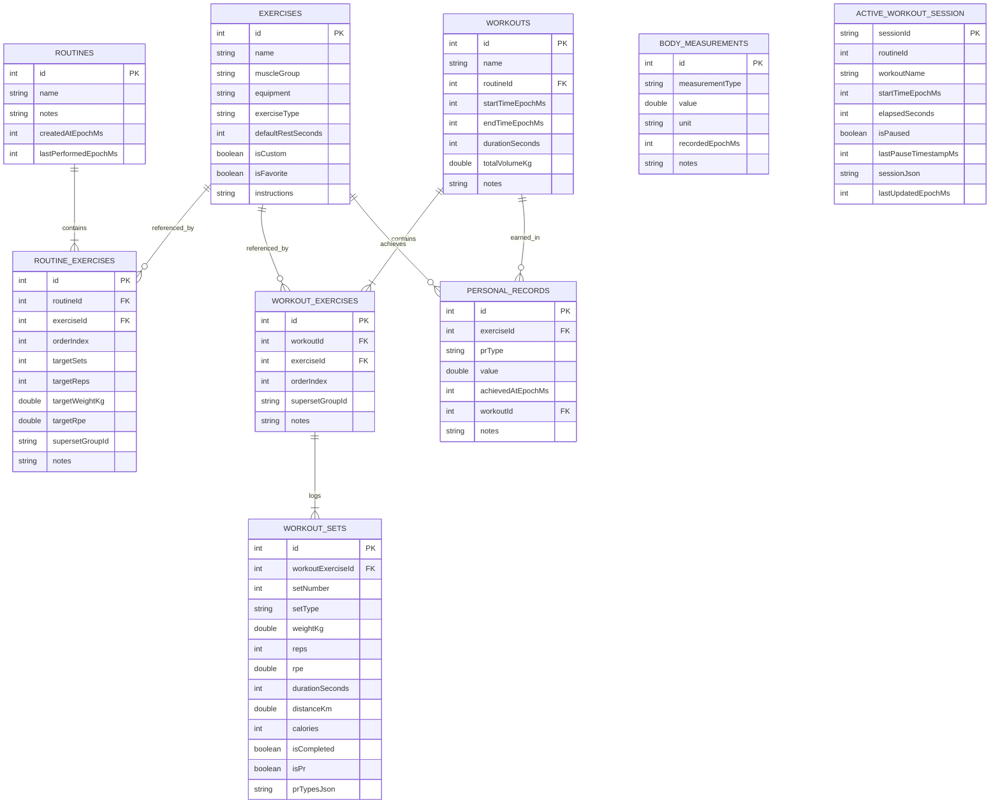

# FitLog Pro — Relational Database Schema & Specifications

## 1. Entity-Relationship Overview

FitLog Pro utilizes Room SQLite 2.6.1 with foreign key integrity and cascading deletions.

---

## 2. Table Definitions & Constraints

### 2.1 `exercises`
- **Primary Key:** `id` (INTEGER, AUTOINCREMENT)
- **Columns:**
  - `name`: TEXT NOT NULL
  - `muscleGroup`: TEXT NOT NULL (Enum: CHEST, BACK, LEGS, QUADS, HAMSTRINGS, SHOULDERS, BICEPS, TRICEPS, CORE, CALVES, CARDIO, FULL_BODY, OTHER)
  - `equipment`: TEXT NOT NULL (Enum: BARBELL, DUMBBELL, MACHINE, CABLE, BODYWEIGHT, SMITH_MACHINE, KETTLEBELL, BANDS, CARDIO_MACHINE, OTHER)
  - `exerciseType`: TEXT NOT NULL (WEIGHT_AND_REPS, BODYWEIGHT_REPS, WEIGHTED_BODYWEIGHT, ASSISTED_BODYWEIGHT, CARDIO, REPS_ONLY)
  - `defaultRestSeconds`: INTEGER NOT NULL DEFAULT 90
  - `isCustom`: INTEGER NOT NULL DEFAULT 0 (Boolean)
  - `isFavorite`: INTEGER NOT NULL DEFAULT 0 (Boolean)
  - `instructions`: TEXT NOT NULL DEFAULT ''

### 2.2 `routines`
- **Primary Key:** `id` (INTEGER, AUTOINCREMENT)
- **Columns:**
  - `name`: TEXT NOT NULL
  - `notes`: TEXT NOT NULL DEFAULT ''
  - `createdAtEpochMs`: INTEGER NOT NULL
  - `lastPerformedEpochMs`: INTEGER NULLABLE

### 2.3 `routine_exercises`
- **Primary Key:** `id` (INTEGER, AUTOINCREMENT)
- **Foreign Keys:**
  - `routineId` REFERENCES `routines(id)` ON DELETE CASCADE
  - `exerciseId` REFERENCES `exercises(id)` ON DELETE CASCADE
- **Indices:**
  - `index_routine_exercises_routineId`
  - `index_routine_exercises_exerciseId`
- **Superset Grouping:**
  - `supersetGroupId`: TEXT NULLABLE (e.g., "SS_1") links consecutive exercises performed back-to-back.

### 2.4 `workouts`
- **Primary Key:** `id` (INTEGER, AUTOINCREMENT)
- **Indices:** `index_workouts_startTimeEpochMs`, `index_workouts_routineId`
- **Total Volume Rule:** `totalVolumeKg` strictly aggregates completed non-warmup sets.

### 2.5 `workout_exercises`
- **Primary Key:** `id` (INTEGER, AUTOINCREMENT)
- **Foreign Keys:**
  - `workoutId` REFERENCES `workouts(id)` ON DELETE CASCADE
  - `exerciseId` REFERENCES `exercises(id)` ON DELETE CASCADE

### 2.6 `workout_sets`
- **Primary Key:** `id` (INTEGER, AUTOINCREMENT)
- **Foreign Keys:**
  - `workoutExerciseId` REFERENCES `workout_exercises(id)` ON DELETE CASCADE
- **Indices:** `index_workout_sets_workoutExerciseId`
- **Set Types:** `NORMAL`, `WARMUP`, `DROP_SET`, `FAILURE`.

### 2.7 `personal_records`
- **Primary Key:** `id` (INTEGER, AUTOINCREMENT)
- **Foreign Keys:**
  - `exerciseId` REFERENCES `exercises(id)` ON DELETE CASCADE
  - `workoutId` REFERENCES `workouts(id)` ON DELETE SET NULL
- **Indices:** `index_personal_records_exerciseId_prType`
- **PR Categories:** `HEAVIEST_WEIGHT`, `BEST_1RM`, `BEST_SET_VOLUME`, `MOST_REPS`.

### 2.8 `body_measurements`
- **Primary Key:** `id` (INTEGER, AUTOINCREMENT)
- **Indices:** `index_body_measurements_recordedEpochMs_measurementType`
- **Types:** `WEIGHT`, `BODY_FAT`, `CHEST`, `WAIST`, `ARMS`, `THIGHS`, `CALVES`, `SHOULDERS`, `HIPS`, `NECK`.

### 2.9 `active_workout_session`
- **Primary Key:** `sessionId` (TEXT)
- **Purpose:** Crash recovery and process reconstitution. Singleton row `"CURRENT_ACTIVE_SESSION"`.
